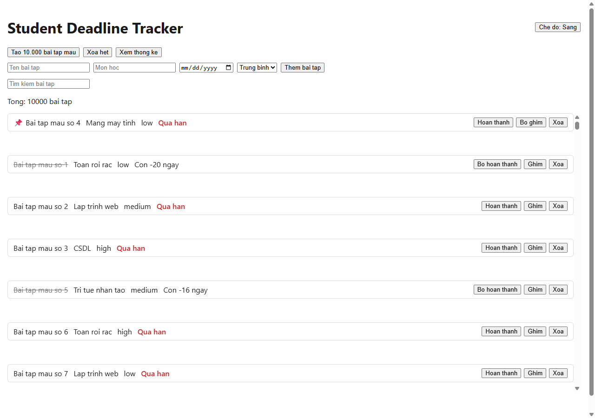
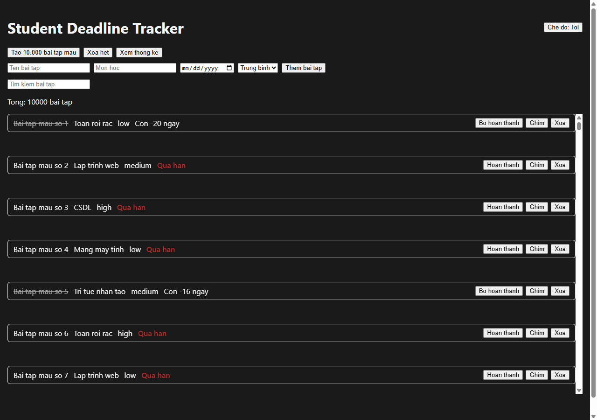
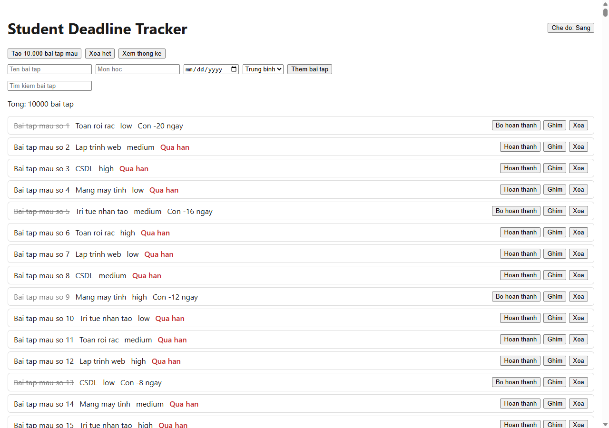
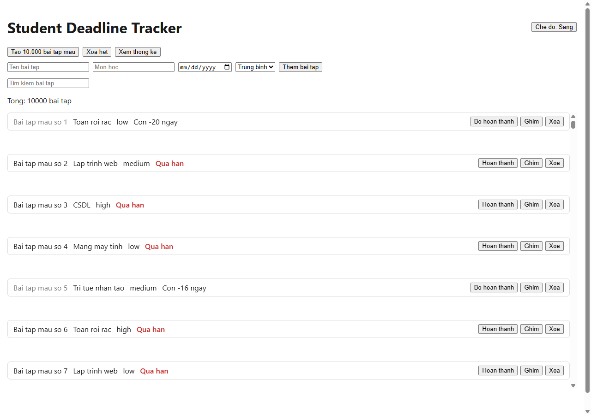
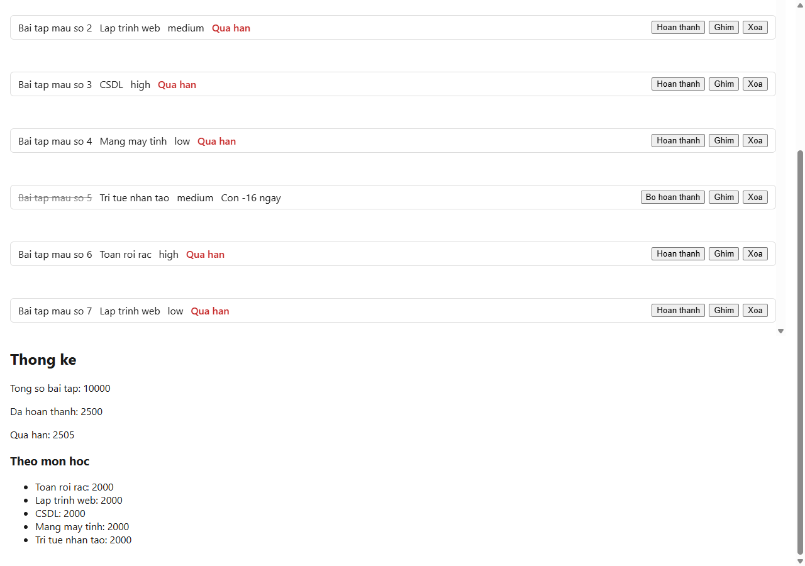

# B23DCCC004 - LTWNC - Thực hành 2

Student Deadline Tracker, nâng cấp từ bài thực hành 1.

## Chạy

```bash
npm install
npm run dev
npm test
```

## Phần A

- **Ghim bài tập (Zustand)**: `src/store/usePinStore.ts` gồm `pinnedIds`, `togglePin`, `isPinned`.
  Bài đã ghim được đẩy lên đầu danh sách. Không đưa vào Redux vì đây chỉ là state giao diện.
- **Theme sáng/tối (Context)**: `src/contexts/ThemeContext.tsx`, value bọc `useMemo`.
  `App` không gọi `useTheme()` để khỏi re-render cả cây, class theme đặt trong `ThemeProvider`.
- **Redux middleware**: thêm `redux-logger`, dùng dynamic import trong `if (isDev)` nên bản
  production không dính logger (bundle 200 kB -> 177 kB).

Ghim bài tập (bài số 4 được ghim nên nhảy lên đầu):



Theme tối:



Log của `redux-logger` khi thêm, hoàn thành và xoá bài tập: xem
[docs/06-redux-logger-console.txt](docs/06-redux-logger-console.txt)

```
[startGroup] action assignments/addAssignment
[log] prev state / action / next state
[startGroup] action assignments/toggleComplete
[log] prev state / action / next state
[startGroup] action assignments/removeAssignment
[log] prev state / action / next state
```

## Phần B

Nút "Tạo 10.000 bài tập mẫu" để stress test. 4 kỹ thuật tối ưu:

1. `React.memo` cho `AssignmentCard` + `useCallback` cho các handler.
2. `useDebounce` 300ms cho ô tìm kiếm + `useMemo` cho phần lọc.
3. `react-window` để ảo hoá danh sách 10.000 bài.
4. `React.lazy` + `Suspense` cho trang Thống kê.

### Trước / sau khi tối ưu

Đo thật trên bản build production, trang có sẵn 10.000 bài tập.
Lighthouse chạy headless Chrome, mỗi bản đo 3 lần.

| Chỉ số | Trước | Sau |
|---|---|---|
| Lighthouse Performance | 65 - 70 | **100** |
| Total Blocking Time | 2.370 - 3.770 ms | **0 - 40 ms** |
| Largest Contentful Paint | 1,9 - 2,5 s | **1,4 s** |
| Speed Index | 3,0 - 4,3 s | **1,4 s** |
| Số card trong DOM | 10.000 | **9** |
| Kích thước DOM | 3,4 MB | **4,8 KB** |
| Độ trễ 1 lần gõ ô tìm kiếm | 145 ms | **4 ms** |

Bản "trước" là bản đã gỡ bỏ `react-window`, `React.memo`, `useDebounce` và `React.lazy`.

Trước tối ưu - render hết 10.000 card, thanh cuộn rất nhỏ:



Sau tối ưu - chỉ render 9 card đang nhìn thấy:



Trang Thống kê (tách chunk riêng bằng `React.lazy`):



## Phần C

Jest + ts-jest + React Testing Library, `coverageThreshold` 70% trong `jest.config.ts`.

| Loại | Số test |
|---|---|
| Unit (utils, reducer) | 22 |
| Component (RTL + userEvent) | 10 |
| Bất đồng bộ (API mock) | 3 |
| Hook (fake timers) | 3 |
| Khác (store, memo, logger, stats) | 8 |

### Kết quả chạy `npm test`

```
Test Suites: 11 passed, 11 total
Tests:       46 passed, 46 total
Time:        12.815 s
```

### Kết quả chạy `npm run test:coverage`

```
----------------------|---------|----------|---------|---------|
File                  | % Stmts | % Branch | % Funcs | % Lines |
----------------------|---------|----------|---------|---------|
All files             |   96.89 |    85.71 |   89.13 |   96.64 |
 assignments          |   96.68 |    85.71 |   88.09 |   96.45 |
  AssignmentCard.tsx  |   92.85 |    85.71 |      80 |   92.85 |
  AssignmentForm.tsx  |     100 |      100 |     100 |     100 |
  AssignmentList.tsx  |   91.66 |       70 |   71.42 |   90.69 |
  assignmentsSlice.ts |     100 |    66.66 |     100 |     100 |
  utils.ts            |     100 |      100 |     100 |     100 |
 stats                |     100 |      100 |     100 |     100 |
  StatsPage.tsx       |     100 |      100 |     100 |     100 |
----------------------|---------|----------|---------|---------|
```

Coverage statements cho `features/` đạt **96.89%**, vượt mức 70% đề bài yêu cầu.

### Kết quả chạy `npm run build`

```
dist/index.html                      0.49 kB │ gzip:  0.30 kB
dist/assets/index-B12XFm0l.css       0.66 kB │ gzip:  0.34 kB
dist/assets/StatsPage-Cs64SJfM.js    0.53 kB │ gzip:  0.33 kB
dist/assets/hooks-DumNWk0A.js       12.37 kB │ gzip:  4.69 kB
dist/assets/index-B8QBUAsj.js      177.64 kB │ gzip: 59.02 kB
```

`StatsPage` được tách thành chunk riêng, chứng tỏ `React.lazy` hoạt động đúng.
Bản production không còn mã của `redux-logger`.
